# 🏛️ `bond-valuation-skill` (Bond ETF Relative Valuation)

> A reproducible, evidence-led valuation and decision framework for bond ETFs and individual fixed-income instruments—evaluating verified primary market data, duration/credit/FX risk decomposition, 1-year and 5-year scenario total returns, and reverse-priced entry hurdles.

---

## 📖 Overview & Purpose

The `bond-valuation-skill` delivers an institutional-grade, evidence-grounded framework to value bond ETFs and fixed-income assets. It answers the fundamental question: **"Does the current market price of this bond ETF compensate an investor for its duration, credit, liquidity, and currency risks relative to available risk-free benchmarks?"**

Fixed-income investing is plagued by widespread cognitive traps and retail misconceptions:
- **Distribution yield is NOT yield to maturity (YTM)**: Chasing high monthly dividend yields frequently leads investors into capital erosion or funds with high Return of Capital (ROC).
- **A perpetual rolling bond ETF never matures at par**: Unlike an individual bond that pays face value at maturity, a rolling ETF constantly turns over its portfolio, keeping duration relatively constant and remaining permanently exposed to interest rate cycles.
- **Fed rate cuts do NOT move long-term yields 1:1**: Central bank policy moves directly impact the front end of the curve; long-term Treasury yields (e.g., 20Y+ Treasuries in TLT) depend on term premium, inflation expectations, and economic growth.
- **A modeled entry threshold is NOT intrinsic value**: Bond ETFs track underlying indices; reverse pricing determines the price required to meet a specific hurdle return, not a metaphysical "fair price" detached from market curves.

---

## 🎯 Core Principles & Stopping Rules

1. **Evidence Hierarchy & Data Provenance**:
   - Prioritize primary issuer disclosures: official fund fact sheets, monthly portfolio reports, prospectuses, daily full holdings files, and index provider methodologies.
   - Supplement with official central bank and Treasury yield curves.
   - Tag every material data input: `Verified official`, `Verified secondary`, `Proxy`, `Assumption`, or `Unavailable`, recording the exact as-of date and timezone.
2. **Stopping Rules**:
   - Never invent or fabricate quotes, yields, or durations. Never reuse previous-chat data as current.
   - If weighted YTM/YTW, effective duration, or data as-of dates cannot be verified, **refuse to assert a definitive fair value or entry price**. Only an explicitly labeled illustrative sensitivity model may be provided.
3. **Total Return Over Yield**:
   - Valuations evaluate expected net total returns (capital gain/loss + carry + roll-down + reinvestment - expenses - default drag), never naive distribution yields.
4. **Currency & Tax Realism**:
   - For non-USD investors (e.g. TWD investors holding US-domiciled ETFs or local sub-funds like 00679B), explicitly model FX trends, hedging costs, and withholding taxes without double-counting.

---

## 🏗️ Architecture & Analytical Workflow

```mermaid
flowchart TD
    Trigger(["User Query\n('Value TLT' / '分析 00679B' / 'Compare BND vs AGG')"]) --> Step1["Phase 1: Instrument & Identifiers\n• Ticker, Legal Name, CUSIP/ISIN, Domicile\n• Index, Hedging Policy, Target Maturity vs Rolling"]
    Step1 --> Step2["Phase 2: Evidence Retrieval & Tagging\n• Issuer Factsheet, Prospectus, Daily Holdings\n• As-Of Dates, Treasury Curves, OAS Benchmarks"]
    Step2 --> Step3["Phase 3: Metric Extraction & Verification\n• Price, NAV, Premium/Discount, YTM/YTW\n• Effective Duration, Convexity, Average Maturity\n• Ratings, Sector Weights, Expense Ratio, ROC"]
    Step3 --> Step4["Phase 4: Risk-Free & Benchmark Curve Matching\n• Duration-matched risk-free Treasury yield\n• Curve-matched OAS (avoid single-tenor naive spreads)"]
    Step4 --> Step5["Phase 5: Relative Required Return Hurdle\n• R_required = R_rf + Policy Risk Premiums\n(Duration, Credit, Liquidity, FX/Tax)"]
    Step5 --> Step6["Phase 6: Total Return Scenarios (1Y & 5Y)\n• Bear / Base / Bull Interest Rate & Spread Shifts\n• Price Return = -D_rate·Δr - D_spread·Δs + 0.5·C·(Δy)²\n• Carry + Roll-down - TER - Default Drag\n• 5Y Rolling Cash Flow & Terminal NAV Simulation"]
    Step6 --> Step7["Phase 7: Reverse Pricing & Margin of Safety\n• Discount Cash Flows & Terminal NAV at R_required\n• Calculate Entry Range & Margin of Safety vs Price"]
    Step7 --> Step8["Phase 8: Synthesis & Decision\n• Hold / Add / Reduce / Watch with Confidence\n• Falsification Triggers & Monitoring Checkpoints"]
```



---

## 🧮 Valuation Model & Mathematical Mechanics

Detailed mathematical definitions and formulas are documented in [references/model.md](references/model.md).

### 1. Single Bond Pricing

$$P = \sum_{t=1}^{m \cdot T} \frac{C / m}{\left(1 + \frac{y}{m}\right)^t} + \frac{M}{\left(1 + \frac{y}{m}\right)^{m \cdot T}}$$

*Where $C$ is annual coupon, $m$ is payment frequency, $M$ is par redemption value, and $y$ is yield to maturity.*

### 2. Rolling Bond ETF Price Sensitivity (Rate, Spread, and Convexity)

For marginal shifts in benchmark rates and credit spreads:

$$\frac{\Delta P}{P} \approx -D_{\text{rate}} \Delta r - D_{\text{spread}} \Delta s + \frac{1}{2} \text{Convexity} (\Delta y)^2$$

*Note: All rate shifts use decimal units ($50 \text{ bps} = 0.0050$). Do not apply total duration to both rate and spread independently unless the methodology explicitly supports it.*

### 3. One-Year Total Return Approximation

$$\text{Total Return}_{1Y} \approx \text{Carry} + \text{Roll-Down} - D_{\text{rate}} \Delta r - D_{\text{spread}} \Delta s + \frac{1}{2} \text{Convexity} (\Delta y)^2 - \text{TER} - \text{Credit Loss} \pm \Delta \text{FX}$$

### 4. Five-Year Rolling ETF Total Return & Cash Flow Model

For a perpetual rolling ETF over a 5-year horizon, the framework avoids assuming current YTM remains static. It models:
- Year-by-year cash distributions reflecting rolling reinvestment yields.
- Terminal NAV at year 5 based on the projected 5-year forward yield curve and spread environment.
- Nominal USD and TWD internal rate of return (IRR).

### 5. Relative Return Hurdle & Reverse Pricing

$$R_{\text{required}} = R_{\text{risk-free, matched}} + \text{Premium}_{\text{duration}} + \text{Premium}_{\text{credit}} + \text{Premium}_{\text{liquidity/structural}}$$

The maximum entry threshold ($P_{\text{entry}}$) to achieve $R_{\text{required}}$ is derived by discounting projected distributions and terminal value:

$$P_{\text{entry}} = \sum_{t=1}^T \frac{\text{CF}_t}{(1 + R_{\text{required}})^t} + \frac{\text{Terminal Value}_T}{(1 + R_{\text{required}})^T}$$

$$\text{Margin of Safety} = \frac{P_{\text{entry}} - P_{\text{market}}}{P_{\text{entry}}}$$

### 6. Currency Conversion (Unhedged USD $\rightarrow$ TWD)

$$R_{\text{TWD}} = (1 + R_{\text{USD}}) \times \left(\frac{\text{FX}_{\text{end}}}{\text{FX}_{\text{start}}}\right) - 1$$

*(Where $\text{FX}$ is TWD per 1 USD.)*

---

## 📊 Fixed-Income Metrics & Pitfalls Matrix

| Metric | Definition | Critical Pitfall to Avoid | Proper Application in Model |
|:---|:---|:---|:---|
| **Distribution Yield (30-day / 12-month)** | Annualized trailing cash payouts divided by current price | Confusing distribution yield with expected return; ignoring Return of Capital (ROC) | Use solely to evaluate historical cash payout cadence |
| **SEC 30-Day Yield** | Standardized net investment income earned over the last 30 days after expenses | Assuming SEC yield is locked in for the life of an ETF | Proxy for current net portfolio earning power |
| **Yield to Maturity (YTM)** | Weighted internal rate of return of all underlying bonds assuming held to maturity | Assuming the ETF will deliver YTM if held 5–10 years | Snapshot baseline for carry calculation |
| **Yield to Worst (YTW)** | Minimum YTM accounting for callable bonds | Using YTM instead of YTW on corporate/high-yield funds | Essential baseline for callable corporate debt |
| **Effective Duration** | Percentage price sensitivity to a 100 bps parallel curve shift | Assuming duration is static as rates change (ignoring convexity) | Key metric for rate-sensitivity modeling |
| **Option-Adjusted Spread (OAS)** | Credit spread over benchmark curve accounting for embedded options | Subtracting raw YTM from a single Treasury tenor | Benchmark against curve-matched index OAS |

---

## 📋 Required Report Structure

Reports adapt to the user's language (defaulting to Traditional Chinese or English based on prompt) and follow an 8-part institutional structure:

1. **Executive Conclusion & Decision**:
   - Clear stance: **Hold** / **Add** / **Reduce** / **Watch** with confidence rating.
   - Data freshness timestamp and summary rationale.
2. **Instrument Profile & Primary-Source Provenance Table**:
   - Fund name, ticker, exchange, domicile, index, AUM, expense ratio, premium/discount, distribution policy.
   - Input provenance table listing source URLs, publication dates, and quality tags.
3. **Treasury Curve & Relative-Value Comparison**:
   - Relevant benchmark curve rates (2Y, 5Y, 10Y, 20Y, 30Y).
   - Matched credit OAS and historical spread percentile.
4. **Risk Decomposition**:
   - Duration, convexity, credit quality distribution (AAA to Below IG), sector concentration, and FX hedging policy.
5. **Bear / Base / Bull Scenarios (1-Year & 5-Year)**:
   - Explicit rate shift ($\Delta r$), spread shift ($\Delta s$), carry, roll-down, and default assumptions.
   - Projected annual cash flows, terminal NAV, total return, and IRR (USD and local currency).
6. **Required Return Hurdle & Reverse-Priced Entry Range**:
   - Defensible $R_{\text{required}}$ calculation.
   - Calculated entry threshold $P_{\text{entry}}$, sensitivity matrix, and margin of safety vs. current market price.
7. **Income Sustainability & Cash Flow Quality**:
   - Net spendable cash flows, ROC history, tax considerations, and portfolio concentration limits.
8. **Decision Triggers & Monitoring Checklist**:
   - What macro or fundamental data would invalidate the thesis.
   - Key upcoming central bank meetings, auctions, and economic releases to watch.

---

## 🚀 Usage & Triggering

### Trigger Scenarios

Trigger this skill when asking to evaluate, compare, or time bond ETFs or individual bonds:

* *"Value bond ETF TLT"* / *"Is TLT attractive at current 20Y yields?"*
* *"分析元大美債20年 (00679B) 或 國泰20年美債 (00687B)"*
* *"Compare BND vs AGG for a core fixed-income allocation"*
* *"Evaluate corporate bond ETF LQD: what is a fair entry price for a 6% hurdle?"*
* *"Is HYG overvalued given tight high-yield spreads?"*
* *"Should I hold or trim my emerging market bond ETF (EMB)?"*

### Example Invocations

```markdown
# Evaluate a US Treasury ETF
"Evaluate TLT at current market price. What is the required entry price for a 5% 5-year annualized return?"

# Compare Taiwanese-domiciled US bond ETFs with FX considerations
"分析 00679B 與 00687B 的溢價率、存續期間與近期配息穩定度，評估目前價位適合加碼還是觀望？"

# Credit ETF Relative Value
"Run a relative valuation on VCIT (Vanguard Intermediate-Term Corporate Bond ETF) against 7-year Treasuries."
```

---

## 📂 File Structure

```
skills/financial/bond-valuation-skill/
├── SKILL.md            # Primary instruction spine (procedures, rules, stopping criteria)
├── README.md           # Comprehensive technical documentation & framework guide (this file)
└── references/
    └── model.md        # Valuation equations, sensitivity math, FX models, and QA checklist
```

---

## 🧪 Verification & Quality Control Checklist

Before delivering any fixed-income assessment, ensure all checks pass:

- [ ] **Fund Identity & As-Of Dates**: Explicitly verify ticker, exchange, currency, and exact portfolio as-of dates.
- [ ] **NAV & Price Cross-Check**: Check premium/discount $= \text{Price} / \text{NAV} - 1$; note if premium/discount is unusually wide ($>0.5\%$).
- [ ] **Yield Verification**: Verify whether quoted YTM/YTW is gross or net of total expense ratio (TER); never infer YTM from distributions.
- [ ] **Curve-Matched Spreads**: Use maturity/duration-matched risk-free rates or index OAS rather than comparing long corporate yields with 10Y Treasuries arbitrarily.
- [ ] **Convexity Math**: Ensure decimal units are used in convexity equations ($\frac{1}{2} C (\Delta y)^2$).
- [ ] **TWD/FX Integration**: For foreign assets, explicitly evaluate USD/TWD exchange rate assumptions and tax drag.
- [ ] **Entry Price vs. Market Reality**: Clearly label reverse-priced entry thresholds as conditional model targets, never guaranteed intrinsic values.

---

## 📜 Changelog

| Version | Date | Changes |
|:---|:---|:---|
| **v1.0.0** | 2026-10-19 | Initial release of `bond-valuation-skill` (`bond-etf-relative-valuation`): evidence-led valuation, duration/credit/convexity decomposition, 1Y and 5Y Bear/Base/Bull scenario modeling, reverse-priced entry hurdles, and full primary source provenance tagging. |
