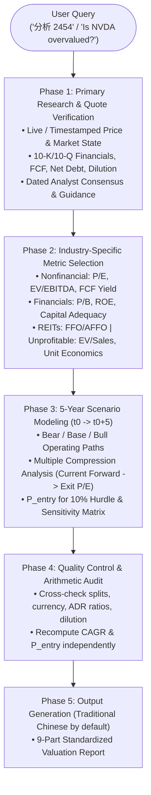

# 📈 `equity-valuation` Skill

> Rigorous 5-year fundamental valuation framework to assess whether a publicly traded stock price is attractive relative to a 10% annualized return hurdle, accounting for business drivers, scenario paths, and valuation compression.

---

## 📖 Overview

The `equity-valuation` skill is an analytical investment research framework. It shifts the question from *"Is this a great business?"* to **"Does the current stock price offer an attractive risk-adjusted five-year return?"**

Even market-leading, high-growth companies can deliver subpar investor returns if purchased at excessive multiples vulnerable to multiple compression. This skill enforces disciplined research into primary financial filings, historical and peer multiples, analyst consensus, 5-year earnings trajectory under Bear/Base/Bull scenarios, and explicit margin of safety calculations against a **10% annualized total-return hurdle**.

---

## 🎯 Core Philosophy & Principles

1. **Price vs. Company Quality**: A fantastic company at 80x forward earnings may be a terrible 5-year investment. Valuation determines investment return.
2. **5-Year Horizon & 10% Hurdle Rate**: Default evaluation evaluates the stock over a **5-year holding period** aiming for $\ge 10\%$ annualized total return ($r = 0.10$).
3. **Valuation Compression Reality**: High-growth multiples inevitably compress as companies mature and scale. The framework explicitly models and quantifies P/E contraction from current forward multiples to normalized exit multiples.
4. **Primary Source Integrity**: Prioritize primary regulatory filings (10-K, 10-Q, interim/annual reports), official earnings releases, and verified timestamped market quotes. Never fabricate quotes or reuse stale prices.
5. **Conditional Decision-Making**: Conclusions are framed as conditional valuation judgments (e.g. *"Attractive below \$145 under base assumptions"*), never guaranteed prophecies or technical chart support levels.

---

## 🏗️ Architecture & Analytical Workflow



---

## 🔍 Research Protocol & Primary Source Verification

For every fresh valuation analysis, the skill strictly adheres to the following research rules:

1. **Market Quote Verification**:
   - Identify ticker, exchange, share class, currency, and latest timestamped price.
   - Note whether the quote is live, delayed, or last close. Never fabricate or guess a quote.
2. **Financial Data Verification**:
   - Extract diluted share count, EPS, trailing net income, operating cash flow, capital expenditure (CapEx), free cash flow (FCF), cash/debt structure, operating margins, ROIC, and share dilution/buyback trends from latest primary filings.
3. **Consensus & Management Guidance**:
   - Retrieve dated analyst consensus forecasts for the next 2–3 fiscal years (recording sample size and range where available).
   - Distinguish consensus estimates from official management guidance and proprietary model assumptions.
4. **Historical & Peer Multiples**:
   - Benchmark historical multiple ranges and medians over 3–5+ years.
   - Select genuinely comparable peers (adjusting for business mix, cyclicality, accounting standards, and growth profile).
5. **Source Attribution**:
   - Cite each material time-sensitive datum with source name and publication date. Explain discrepancies if multiple sources conflict.

---

## 📊 Metric Selection Matrix by Industry

Never apply a one-size-fits-all P/E multiple across different business models:

| Industry / Business Archetype | Primary Valuation Metrics | Key Balance Sheet & Quality Indicators | Common Pitfalls to Avoid |
|:---|:---|:---|:---|
| **Profitable Nonfinancial** (Tech, Consumer, Industrial) | TTM & Forward P/E, EV/EBIT, EV/EBITDA, P/FCF, FCF Yield | Operating margin trend, ROIC, Net Debt / EBITDA, share dilution | Ignoring SBC (stock-based compensation) dilution; treating peak earnings as permanent |
| **Financial Institutions** (Banks, Insurance) | P/B, P/TBV, P/E | ROE, CET1 capital adequacy, NPL ratio, net interest margin (NIM) | Using EV/EBITDA (meaningless due to interest-driven revenue model) |
| **Real Estate & Infrastructure** (REITs, Utilities) | P/FFO, P/AFFO, Dividend Yield | Debt/Equity, weighted average debt maturity, occupancy rate | Relying on GAAP net income distorted by high non-cash depreciation |
| **Unprofitable / Early-Stage** | EV/Sales, Gross Profit Multiple | Cash runway, burn rate, unit economics (CAC/LTV), dilution rate | Meaningless negative P/E or PEG ratios |
| **Cyclical / Commodity** (Semiconductors, Shipping, Materials) | Normalized midcycle P/E, EV/IC (Invested Capital) | Trough-to-peak cash generation, maintenance CapEx | Buying at "low" peak P/E ratios at the top of an earnings cycle |

---

## 🧮 Valuation Model & Mathematical Mechanics

### 1. Terminal EPS Projection ($t_0 \rightarrow t_5$)

Forecast earnings per share 5 years from the current observation date $t_0$:

$$EPS_T = EPS_{\text{base}} \times \prod_{t=1}^T (1 + g_t)$$

Explicit year-by-year projections are preferred, utilizing credible consensus estimates for years 1–2 and justified normalized growth rates for years 3–5.

### 2. Terminal Price ($P_T$)

$$P_T = EPS_T \times \text{Exit P/E}$$

*(Adjust for net debt, minority interests, or expected share dilution where applicable.)*

### 3. Scenario Price CAGR

$$\text{Price CAGR} = \left(\frac{P_T}{P_0}\right)^{1/T} - 1$$

### 4. Maximum Entry Price for 10% Hurdle ($P_{\text{entry}}$)

To earn the required annualized hurdle return $r = 10\%$ ($0.10$):

* **Without Dividends**:
  $$P_{\text{entry}} = \frac{P_T}{(1 + r)^T} = \frac{P_T}{1.10^5} \approx \frac{P_T}{1.61051}$$

* **With Dividends**:
  $$P_{\text{entry}} = \sum_{t=1}^T \frac{D_t}{(1 + r)^t} + \frac{P_T}{(1 + r)^T}$$
  *(Or compute exact internal rate of return [IRR] matching dividend timing and tax considerations.)*

### 5. Margin of Safety & Price Gap

$$\text{Margin of Safety} = \frac{P_{\text{entry}} - P_0}{P_{\text{entry}}}$$

$$\text{Price Gap to Entry} = \frac{P_{\text{entry}}}{P_0} - 1$$

---

## 📉 Scenarios & Multiple Compression

High valuation multiples reflect optimistic market expectations. As companies grow, revenue base expansion inevitably leads to growth deceleration and multiple compression:

* **Bear Case**: Conservative operating growth, margin contraction, aggressive exit multiple compression.
* **Base Case**: Reasonable consensus execution, normalized growth, modest multiple compression.
* **Bull Case**: Outperformance in new markets/catalysts, margin expansion, resilient terminal multiple.

### Quantifying Double Jeopardy Risk

The model specifically stress-tests the simultaneous occurrence of:
1. An operational or earnings miss ($EPS_T < \text{Forecast}$), **and**
2. Accelerated multiple compression ($\text{Exit P/E} \ll \text{Current Forward P/E}$).

A sensitivity grid evaluates terminal growth vs. exit multiple combinations to reveal break-even assumptions priced into current trading levels.

---

## 📋 9-Part Standard Output Structure

Valuation reports default to **Traditional Chinese (繁體中文)**:

1. **裁決先行 (Verdict First)**:
   - 定性結論：**明顯低估 (Significantly Undervalued)** / **合理區間 (Approximately Fair)** / **高估 (Expensive)** / **資訊不足難以定論 (Too Uncertain)**
   - 信心程度與一兩句話核心結論（明確標註基於何種假設，非絕對定論）。
2. **即時報價卡 (Quote Card)**:
   - 代號、交易所、股價、報價時間戳記、幣別、市場狀態（盤中/延遲/收盤）。
3. **基本面與評價現況 (Fundamentals & Current Valuation)**:
   - TTM 與 Forward 本益比、歷史倍數區間/中位數、同業倍數比較、自由現金流殖利率、資產負債健全度（淨現金/負債）。
4. **成長動能與市場共識 (Growth Drivers & Consensus)**:
   - 近 2–3 年分析師共識營收/EPS 預估表，嚴格區分歷史實績、共識數據與模型推估。
5. **三情境五年度推演 (Bear/Base/Bull 5-Year Scenarios)**:
   - 包含 5 年後預估 EPS、出場本益比、目標價、股價 CAGR、含息總報酬 CAGR，以及對應 10% 年化要求的**最高買進價 ($P_{\text{entry}}$)**。
6. **敏感度與倍數壓縮分析 (Sensitivity & Valuation Compression)**:
   - 終端成長率 vs. 出場本益比敏感度二維矩陣，量化倍數壓縮風險並說明目前股價內含之隱含預期 (priced-in expectations)。
7. **催化劑與主要風險 (Catalysts, Invalidation & Risks)**:
   - 下次財報發布日、推升/破壞評價之關鍵催化劑、論點失效條件 (Invalidation conditions)。
8. **投資決策建議 (Decision & Actionable Entry Price)**:
   - 根據 10% 要求報酬率給予明確的條件式買進評價區間（非技術面支撐線），並點出需持續追蹤的不確定性因素。
9. **資料來源與計算備註 (Citations & Calculation Notes)**:
   - 具體引述官方財報、申報文件日期、共識數據來源與關鍵會計處理備註。

---

## 🚀 Usage & Triggering

### Trigger Phrases

This skill activates automatically when requesting stock valuation, fair value assessment, or entry hurdle analysis:

* *"分析 2454"* / *"分析台積電 2330"*
* *"Is NVDA overvalued?"* / *"Is Apple reasonably priced right now?"*
* *"What is a fair entry price for GOOGL for a 10% annual return?"*
* *"計算微軟 MSFT 5年合理的本益比與目標價"*
* *"評估這檔股票是否高估"*

### Custom Overrides

Default parameters can be adjusted directly in your prompt:
* Custom holding horizon: *"以 3 年為週期評估..."*
* Custom hurdle rate: *"以 15% 要求年化報酬率計算買進價位..."*
* Specific currency or dividend tax considerations: *"以除息後稅率 30% 計算淨報酬..."*

---

## 📂 File Structure

```
skills/financial/equity-valuation/
├── SKILL.md      # Primary instruction spine (objectives, formulas, rules, output schema)
└── README.md     # Detailed documentation, rationale, and mathematical mechanics (this file)
```

---

## 🧪 Verification & Quality Control Checklist

Before delivering any valuation assessment:

- [ ] **Data Authenticity**: All quotes and EPS numbers correspond to primary sources with timestamp/date. No fabricated quotes.
- [ ] **Arithmetic Verification**: Independently verify $P_T$, CAGR, and $P_{\text{entry}}$ calculations. Check shares outstanding $\times$ price vs. market cap.
- [ ] **Unit & Split Integrity**: Account for stock splits, share classes, ADR ratios, and reporting currency vs. listing currency.
- [ ] **Total Return Alignment**: Ensure dividend cash flows are modeled when calculating the 10% total return hurdle for dividend-paying stocks.
- [ ] **Uncertainty Transparency**: Clearly state critical operating assumptions, multiple compression risks, and thesis invalidation triggers.

---

## 📜 Changelog

| Version | Date | Changes |
|:---|:---|:---|
| **v1.0.0** | 2026-10-19 | Initial release of `equity-valuation` skill: 5-year investment horizon, 10% annualized total return hurdle, industry-specific metric selection, Bear/Base/Bull scenario modeling, valuation compression quantification, and 9-part Traditional Chinese output template. |
